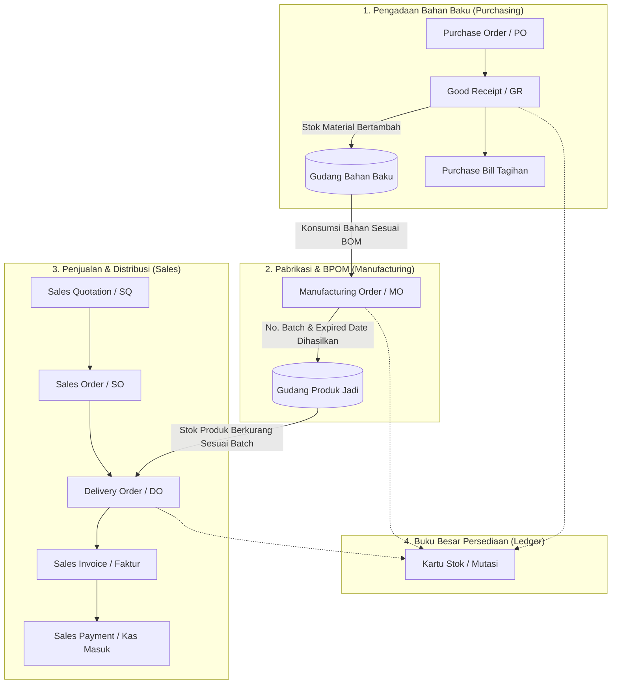

# 🧴 Skinnova ERP - Skincare & Cosmetics Management System

<p align="center">
  
  
  
  
  
</p>

**Skinnova ERP** adalah sistem manajemen terpadu (*Enterprise Resource Planning*) yang dirancang khusus untuk industri **skincare, kosmetik, dan manufaktur maklon**. Sistem ini mencakup alur lengkap dari pengadaan bahan baku, proses produksi farmasi/kosmetik sesuai standar **BPOM**, manajemen stok gudang berbasis *batch & expired date*, distribusi penjualan, penerbitan faktur, hingga laporan keuangan dan hak akses bertingkat per departemen.

---

## 🌟 Fitur Utama Sistem

### 1. 📊 Dashboard & Analitik Interaktif
* **Statistik Finansial & Operasional (KPI Cards)**:
  * Total Penjualan Tahun Ini (*YTD*) disertai grafik mini tren (*sparkline*).
  * Total Piutang Pelanggan (*Accounts Receivable*) dari invoice belum lunas.
  * Total Hutang Vendor (*Accounts Payable*) dari purchase bill berjalan.
  * Peringatan Dini Stok Rendah (*Safety Stock Alert*) untuk produk dan bahan baku.
* **Visualisasi Grafik (Chart.js)**:
  * **Grafik Tren Penjualan vs Pembelian**: Perbandingan pendapatan penjualan lunas dengan beban pembelian material selama 6 bulan terakhir.
  * **Distribusi Status Sales Order**: Diagram status pesanan pelanggan (*Draft, Dikonfirmasi, Terkirim, Dibatalkan*).

### 2. 🧴 Kepatuhan Standar BPOM & Batch Tracking
* **Master Produk**: Dilengkapi atribut **Nomor Registrasi BPOM** (misal: `NA18240101234`) dan masa simpan (*Shelf Life*, contoh: 24 bulan).
* **Penomoran Batch Otomatis**: Setiap *Manufacturing Order (MO)* otomatis memiliki nomor batch berstandar farmasi (`BATCH-YYYYMM-XXXX`).
* **Kalkulasi Expired Date Otomatis**: Saat produksi selesai (*Done*), tanggal kadaluarsa dihitung otomatis dari tanggal selesai ditambah masa simpan produk.
* **Pelacakan Pengiriman**: Staf gudang dapat mencatat nomor batch produk yang dikirimkan pada *Delivery Order (Surat Jalan)* untuk mempermudah audit jika terjadi *product recall*.

### 3. 📦 Kartu Stok / Mutasi Stok (*Inventory Movement Ledger*)
* Pencatatan audit trail otomatis setiap kali ada pergerakan barang (tanpa manipulasi manual):
  * **Barang Masuk (IN)**: Penerimaan dari Vendor (*Good Receipt*), Hasil Produksi (*Manufacturing Order*), Penyesuaian Positif.
  * **Barang Keluar (OUT)**: Pengiriman ke Pelanggan (*Delivery Order*), Konsumsi Bahan Baku Produksi (*BOM*), Penyesuaian Negatif.
* Riwayat mencatat: Waktu, Jenis Barang, Nama Barang, Nomor Batch, Expired Date, Kuantitas, Stok Awal, dan Saldo Akhir.
* Fitur **Export Kartu Stok ke Excel/CSV**.

### 4. 🛍️ Alur Penjualan & Distribusi (*Sales & Distribution*)
* **Sales Quotation (SQ)**: Surat penawaran harga ke pelanggan/klinik/distributor.
* **Sales Order (SO)**: Konfirmasi pesanan resmi dengan kalkulasi subtotal otomatis.
* **Delivery Order (DO) / Surat Jalan**: Pengiriman barang dengan pemotongan stok otomatis dan cetak format Surat Jalan PDF.
* **Sales Invoice & Payment**: Penagihan resmi PPN 11%, pencatatan cicilan/pembayaran parsial, dan cetak Faktur PDF.
* **Export Data**: Tombol Export CSV/Excel pada setiap tabel transaksi.

### 5. 🛒 Pengadaan & Pembelian (*Procurement / Purchasing*)
* **Master Vendor**: Manajemen data pemasok bahan baku dan kemasan.
* **Purchase Order (PO)**: Penerbitan order pembelian bahan baku.
* **Good Receipt (GR)**: Penerimaan fisik barang di gudang dengan penambahan stok material otomatis.
* **Purchase Bill**: Tagihan faktur dari vendor disertai cetak PDF Purchase Bill.

### 6. ⚙️ Manufaktur & Produksi (*Manufacturing*)
* **Bill of Materials (BOM)**: Formula komposisi takaran bahan baku per unit produk.
* **Manufacturing Order (MO)**:
  * Perhitungan estimasi biaya produksi berdasarkan standar biaya bahan di BOM (*COGS / HPP*).
  * Validasi stok material: Sistem mencegah eksekusi MO jika bahan baku tidak mencukupi.
  * Pemotongan otomatis stok bahan baku dan penambahan stok produk jadi saat status *Done*.

### 7. 📑 Halaman Laporan Interaktif (*Reporting*)
* Menu khusus **Laporan &rarr; Laporan Penjualan**:
  * Filter fleksibel: Rentang Tanggal Faktur, Pelanggan, dan Status Pembayaran.
  * Kartu Ringkasan Real-Time: Total Nilai Omset, Total Kas Masuk, dan Sisa Piutang Berjalan.
  * Tabel rincian faktur penjualan interaktif.
  * Tombol **"Export Laporan ke Excel / CSV"** dengan dukungan encoding UTF-8 BOM.

### 8. 👥 Role-Based Access Control (RBAC) & Manajemen Pengguna
Menu admin disaring otomatis berdasarkan departemen/peran karyawan:
* **Administrator**: Akses penuh ke seluruh fitur dan pengaturan pengguna.
* **Sales**: Pelanggan, SQ, SO, DO, Faktur Penjualan, dan Laporan Penjualan.
* **Purchasing**: Vendor, PO, Good Receipt, dan Bahan Baku.
* **Gudang (Inventory)**: Bahan Baku, Produk Jadi, Good Receipt, Delivery Order, Penyesuaian Stok, dan Kartu Stok.
* **Produksi**: BOM, Manufacturing Order, Produk Jadi, Bahan Baku, dan Kartu Stok.
* **Finance**: Faktur Penjualan, Pembayaran Pelanggan, Tagihan Vendor, Kartu Stok, dan Laporan.
* **HR**: Data Karyawan, Departemen, dan Jabatan.

---

## 🏗️ Alur Bisnis Sistem



---

## 🚀 Panduan Instalasi & Menjalankan Proyek

### Prasyarat Sistem
* **PHP** >= 8.2 (ekstensi: `pdo_mysql`, `mbstring`, `openssl`, `tokenizer`, `xml`, `ctype`, `json`, `curl`, `fileinfo`)
* **Composer** >= 2.x
* **MySQL** >= 8.0 (atau MariaDB >= 10.4)
* **Laragon** / XAMPP / Native Web Server

### Langkah-langkah Instalasi

1. **Clone Repository**:
   ```bash
   git clone https://github.com/bagus2719/skinnova-app.git
   cd skinnova-app
   ```

2. **Instal Dependensi PHP**:
   ```bash
   composer install
   ```

3. **Konfigurasi Environment (`.env`)**:
   Salin file konfigurasi environment:
   ```bash
   copy .env.example .env
   ```
   Buka file `.env` dan sesuaikan koneksi database MySQL Anda:
   ```env
   DB_CONNECTION=mysql
   DB_HOST=127.0.0.1
   DB_PORT=3306
   DB_DATABASE=db_skinnova
   DB_USERNAME=root
   DB_PASSWORD=
   ```

4. **Generate Application Key**:
   ```bash
   php artisan key:generate
   ```

5. **Jalankan Migrasi Database**:
   *(Pastikan database `db_skinnova` sudah dibuat di MySQL / Laragon Anda)*
   ```bash
   php artisan migrate
   ```

6. **Seed Data Pengguna Siap Uji (Default Department Roles)**:
   ```bash
   php artisan db:seed --class=RoleUserSeeder
   ```

7. **Buat Symlink Storage**:
   ```bash
   php artisan storage:link
   ```

8. **Jalankan Server Lokal**:
   ```bash
   php artisan serve
   ```
   Akses panel admin di browser Anda: **`http://127.0.0.1:8000/admin`**

---

## 🔑 Akun Default untuk Pengujian (Demo Roles)

Setelah menjalankan `php artisan db:seed --class=RoleUserSeeder`, Anda dapat login menggunakan akun berikut:

| Departemen / Peran | Alamat Email | Password | Hak Akses Utama |
| :--- | :--- | :--- | :--- |
| **Administrator** | `admin@skinnova.com` | `password` | Akses Penuh ke Semua Menu & Kelola User |
| **Sales** | `sales@skinnova.com` | `password` | Pelanggan, SQ, SO, DO, Invoice, Laporan |
| **Purchasing** | `purchasing@skinnova.com` | `password` | Vendor, PO, Penerimaan Barang, Bill |
| **Gudang (Inventory)** | `gudang@skinnova.com` | `password` | Bahan Baku, Produk Jadi, DO, GR, Kartu Stok |
| **Produksi** | `produksi@skinnova.com` | `password` | BOM, Manufacturing Order, Kartu Stok |
| **Finance** | `finance@skinnova.com` | `password` | Invoice, Pembayaran, Bill, Laporan |
| **Human Resources** | `hr@skinnova.com` | `password` | Karyawan, Departemen, Jabatan |

---

## 🛠️ Tech Stack & Library

* **Framework**: [Laravel 12](https://laravel.com)
* **Admin Panel**: [Filament v3](https://filamentphp.com)
* **Database**: MySQL 8.x
* **PDF Generator**: [barryvdh/laravel-dompdf](https://github.com/barryvdh/laravel-dompdf)
* **Data Visualization**: Chart.js (via Filament Widgets)
* **Export Engine**: Custom UTF-8 BOM Streamed CSV Engine (Excel-ready)

---

## 📄 Lisensi
Proyek aplikasi ini dirilis di bawah lisensi [MIT License](LICENSE).
